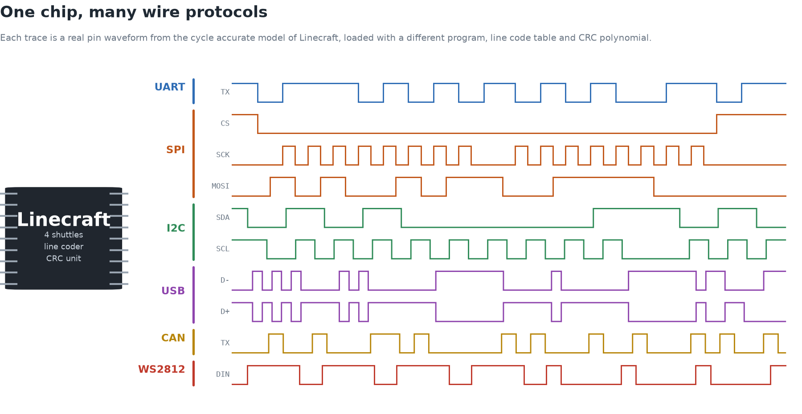
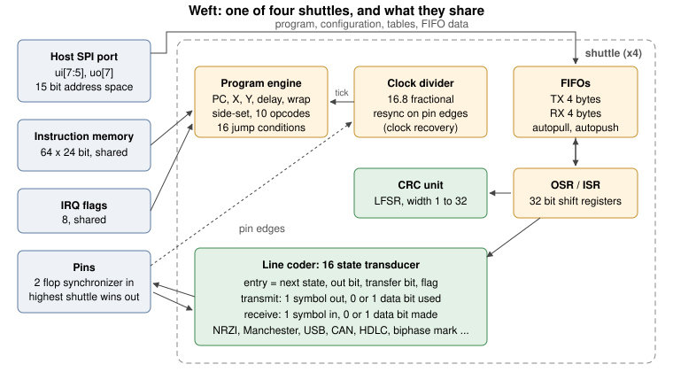
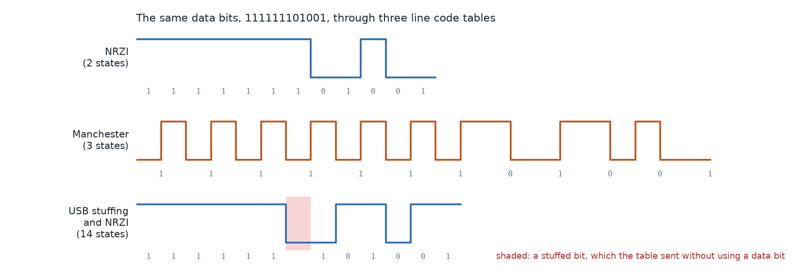
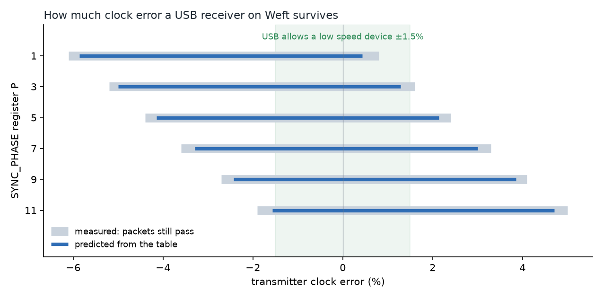
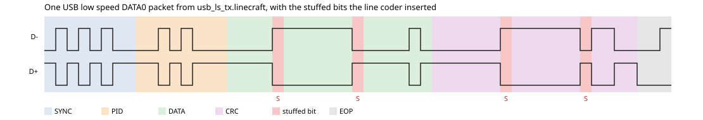
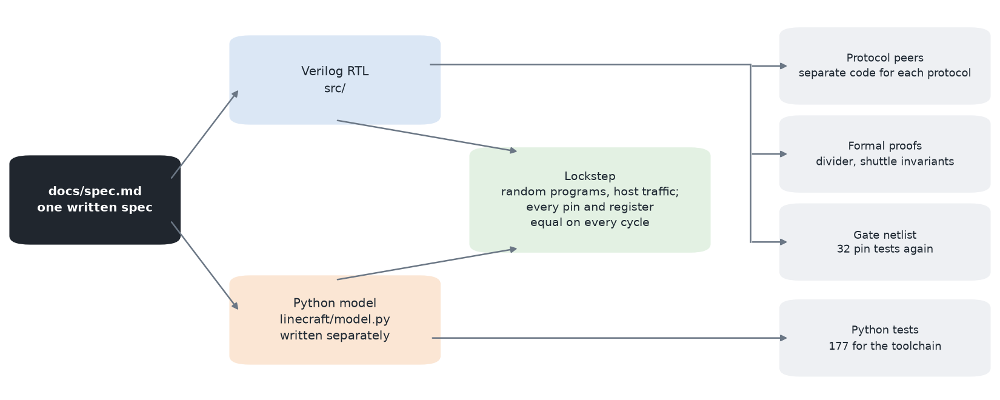

<h1 align="center">Linecraft</h1>

<p align="center">
A small chip that learns new wire protocols from software and can prove things about them before it runs them.<br>
An entry for the Jane Street protocol emulator ASIC competition, on the Tiny Tapeout IHP 130 nm shuttle.
</p>

<p align="center">


</p>



Every gadget talks to other chips over a few wires. A sensor uses I2C, a flash chip uses SPI, a keyboard uses USB and a car uses CAN. Each of these is a protocol, which is a set of rules about when a wire goes high or low and what the pattern means. A normal chip has fixed hardware for each protocol it knows, and it is stuck when it meets one it does not know.

[Jane Street's competition](https://blog.janestreet.com/protocol-emulator-asic-competition/) asks for one small chip that can learn any protocol from software. Linecraft is my entry. You send it a short program over SPI, and it starts to speak that protocol on its pins. The picture above shows six of them, and every trace in it is a real pin waveform from the cycle accurate model of the chip.

Programmable protocol engines already exist. The RP2040's PIO is the best known one, and several entries in this competition build something similar. Linecraft adds one idea on top. Most protocols reshape their bits with a small rule called a line code before the bits reach the wire, and in Linecraft that rule is a table in hardware. A table is a finite state machine, so the toolchain can reason about a line code before the chip ever runs it.

- It **proves** that the receiver always gives back exactly what the transmitter sent.
- It **predicts** how much clock error between two chips the link survives. I measured the prediction in simulation, and it holds at every setting I tried, to within 0.4 percent.
- It **builds the receiver for you** from the transmit rule alone. For every built-in code the derived receiver is the same size as the one I wrote by hand.

## Contents

- [What is inside the chip](#what-is-inside-the-chip)
- [A protocol in twelve lines](#a-protocol-in-twelve-lines)
- [Line codes as tables](#line-codes-as-tables)
- [How much clock error can a receiver survive?](#how-much-clock-error-can-a-receiver-survive)
- [Receivers from transmitters](#receivers-from-transmitters)
- [Checksums that are secretly CRCs](#checksums-that-are-secretly-crcs)
- [The protocols](#the-protocols)
- [How it is verified](#how-it-is-verified)
- [Fitting it on the chip](#fitting-it-on-the-chip)
- [Try it](#try-it)
- [What is in this repository](#what-is-in-this-repository)

## What is inside the chip



Linecraft has four small processors that I call shuttles, after the part of a loom that carries the thread. They share one memory of 64 instructions. Each shuttle moves bits between its pins and its FIFOs with exact cycle timing, and each has three pieces of hardware that the host can reprogram.

| Part | What it does |
| --- | --- |
| Clock divider | Sets the tick rate with 16 integer bits and 8 fraction bits, so 115,200 baud from a 40 MHz clock is within 0.01 percent, and a proof shows the error never builds up over time. It can also restart on every edge of an input pin, which turns it into a simple clock recovery loop |
| Line coder | A 16 state table that turns data bits into line symbols on transmit and back on receive. NRZI, Manchester, USB bit stuffing, CAN bit stuffing and HDLC zero insertion are all just different tables |
| CRC unit | A shift register with any width from 1 to 32 bits and any polynomial, fed by the bits that pass through the shuttle. It checks frames on receive and appends the CRC on transmit |

The instruction set has ten opcodes: `JMP` with 16 conditions, `WAIT`, `IN`, `OUT`, `PUSH`, `PULL`, `MOV`, `SET`, `IRQ` and `CTL`. Every instruction can also hold its pins for up to 31 extra cycles and drive up to three side pins. The host talks to the chip over SPI on four pins, and pins 8 to 15 are bidirectional, with open drain for buses such as I2C. [docs/spec.md](docs/spec.md) is the full definition, with the register map and every corner case.

## A protocol in twelve lines

This is the whole UART transmitter. The shuttle waits for a byte, sends a start bit, shifts out eight data bits and sends a stop bit, and every bit lasts exactly eight ticks.

```
.program uart_tx
    set pins, 1              ; idle high before taking the pin
    set pindirs, 1
.wrap_target
    pull block
    set x, 7
    set pins, 0      [7]     ; start bit
bit:
    out pins, 1      [6]
    jmp x-- bit
    set pins, 1      [7]     ; stop bit
.wrap
```

The assembler in [linecraft/asm.py](linecraft/asm.py) turns this into 24 bit words, and [linecraft/protocols.py](linecraft/protocols.py) adds the configuration for each protocol. A USB or CAN transmitter is not much longer, because the line coder does the stuffing and the CRC unit makes the check bits.

## Line codes as tables



A line code turns data bits into the symbols that go on the wire. NRZI marks a 0 with a change of level. Manchester sends two symbols for every bit, so the line never stays still for long. USB inserts an extra symbol after six 1s in a row, so the receiver always sees a change often enough to keep its clock in step. That inserted bit is the shaded one in the picture.

Each entry in a Linecraft table holds the next state, the output symbol and one extra bit that says whether this step used a data bit. That one bit lets a single table format describe codes that send more symbols than they receive bits. NRZI needs 2 states, Manchester 3, HDLC 6, CAN 11 and USB 14.

Since a table is a finite automaton, the toolchain can analyse it exactly. `python -m linecraft.analysis` does this for every built-in code.

| Code | States | Round trip | Longest run R | Symbols per bit |
| --- | --- | --- | --- | --- |
| NRZI | 2 | proved | unbounded | 1 |
| USB | 14 | proved | 7 | 1 to 7/6 |
| CAN | 11 | proved | 5 | 1 to 5/4 |
| Manchester | 3 | proved | 2 | 2 |
| HDLC | 6 | proved | unbounded | 1 to 6/5 |

The round trip proof explores every pair of encoder and decoder states over every input. The longest run R of equal symbols is a longest path search, and the symbol rate is Karp's minimum and maximum mean cycle. The CAN row shows why exact analysis helps. Its worst case rate is 5/4, which is higher than the 6/5 a quick reading of the rule suggests, because a stuffed bit can start a new run of five.

Tables also compose. `linecodes.compose` chains two transmit tables, so that the symbols of the first become the input bits of the second, and builds one table for the pair. This shows where the 14 states of USB come from. USB is a 7 state bit stuffer followed by the 2 state NRZI coder, and the composed table behaves exactly like the hand-written one on every input, which `analysis.same_transmitter` checks. Composition can also fix a weakness that both parts have on their own. HDLC zero insertion and NRZI each allow runs of unlimited length, but HDLC followed by NRZI, which is the line code of AX.25 packet radio, never holds the line for more than 6 symbols, so a receiver built on it has a guaranteed clock tolerance.

## How much clock error can a receiver survive?

Two chips never run at exactly the same speed, so a receiver slowly drifts against the line. A receiver that resyncs on every edge only drifts while the line stays still, and the table says how long that can be. With R symbols at most between edges, k ticks per bit, a sample point s within the bit and q cycles of jitter from the synchroniser, a receiver with M clock cycles per symbol works for every clock error d with

```
-(1/k - s - q/M) / R  <  d  <  (s - q/M) / R
```

R comes from the table, k from the program, M from the divider, and s from the `SYNC_PHASE` register. To test it, [experiments/cdr_sweep.py](experiments/cdr_sweep.py) sends USB packets full of long runs from one shuttle to a receiver on another, and detunes the transmitter in steps of 0.1 percent until packets fail.



At all six sync phases the measured window sits just outside the predicted one, between 0.20 and 0.37 percent wider on each side. The bound is therefore safe, and it is close to tight. At the middle setting the receiver survives about 3 percent either way, which is twice what the USB specification asks of a low speed device.

My first version of this bound was symmetric, and the experiment broke it on one side. Following that failure up showed that the sample point after an edge depends on the synchroniser delay as well as on `SYNC_PHASE`, and that gave the asymmetric form above. [docs/theory.md](docs/theory.md) has the full argument.

## Receivers from transmitters

Writing a decoder table by hand is where line code bugs live, so the toolchain derives it. [linecraft/synth.py](linecraft/synth.py) takes only the transmit table. The receiver keeps track of the set of transmitter states that could have produced the symbols seen so far, which is the subset construction from automata theory. On each symbol it outputs a bit only when every possible transmitter step used that same bit, and it raises an error flag when no transmitter could have sent the symbol. Moore minimisation then merges equal states, and the round trip checker proves the result.

| Code | Hand-written receiver | Derived receiver | Round trip |
| --- | --- | --- | --- |
| NRZI | 2 states | 2 states | proved |
| USB | 14 states | 14 states | proved |
| CAN | 11 states | 11 states | proved |
| Manchester | 3 states | 3 states | proved |
| HDLC | 6 states | 6 states | proved |

The best test of flexibility is a protocol the chip was not designed for. Biphase mark code, the line code of S/PDIF digital audio, appears nowhere in the design. I wrote its transmit rule in six lines of Python inside a test. The toolchain derived a 4 state receiver, proved the pair, found R = 2, and the chip sent and received four bytes through a loopback with two generic programs. [docs/new_protocol.md](docs/new_protocol.md) walks through the same steps for any new code.

## Checksums that are secretly CRCs

Many protocols use a simple checksum that XORs fixed size pieces of a message together. Each such checksum is a CRC in disguise. A CRC of width W divides the message by its polynomial g(x), and when g(x) = x^W + 1 we have x^W = 1, so every block of W bits folds onto the next one and the remainder is the XOR of all the blocks. Linecraft therefore needs no checksum hardware beyond its CRC unit.

- **Parity.** With W = 1 the polynomial is x + 1, and the CRC is the parity of the message. The UART 8O1 and 8E1 transmitters and the PS/2 receiver use it this way.
- **DShot.** The motor command protocol of drone speed controllers ends each frame with the XOR of its three 4 bit nibbles. That is the CRC with polynomial x^4 + 1, so the chip appends it with `MOV OSR, CRC` like any other CRC.
- **Address matching.** A CRC of width W is a one to one map on W bit messages, so two different 8 bit addresses can never give the same CRC-8. The I2C target loads the CRC of its own address as the check value, and one `JMP CRCOK` after the address byte tells it whether the controller is talking to it.

## The protocols

Every program is in [programs/](programs), and every test drives the chip only through its pins and its SPI port. Each protocol is checked by a peer model written separately from the Linecraft toolchain.

| Protocol | Program | Checked by |
| --- | --- | --- |
| UART 8N1 transmit and receive | `uart_tx`, `uart_rx` | A mid-bit sampling decoder, edge timing at 115,200 baud, and a bad stop bit that must raise an interrupt |
| UART with odd or even parity | `uart_tx_parity` | A frame decoder that checks the parity bit from the 1 bit CRC |
| SPI controller, all four modes | `spi_master` | An SPI target model for each clock polarity and phase |
| SPI target | `spi_target` | An SPI controller model that clocks the chip from its input pins |
| I2C controller write and read | `i2c_write`, `i2c_read` | An open drain target model that checks START, address, ACK, NACK and STOP |
| I2C target | `i2c_target` | A controller model that writes to the chip's address and to another one. The chip answers only its own |
| 1-Wire READ ROM | `onewire` | A device model from the Maxim timing rules. The chip checks the ROM's CRC-8 |
| PS/2 receive | `ps2_rx` | A keyboard model that clocks frames in, with a bad parity bit that must be caught |
| JTAG | `jtag` | A TAP model from IEEE 1149.1 that follows all 16 states. The test reads a 32 bit IDCODE |
| USB low speed transmit | `usb_ls_tx` | A decoder from the USB specification that undoes NRZI and stuffing and checks the CRC16 |
| USB low speed receive | `usb_ls_rx` | Loopback with clock recovery, destuffing and a CRC16 check on the chip |
| CAN 2.0A transmit | `can_tx` | A decoder from ISO 11898 that checks stuff bits, CRC-15 and the frame end |
| Biphase mark (S/PDIF) | `bmc_tx`, `bmc_rx` | A derived receiver and a loopback, described above |
| WS2812 LEDs | `ws2812` | A pulse width decoder that checks every high time |
| DALI lighting control, transmit and receive | `dali_tx`, `dali_rx` | A decoder from IEC 62386 that checks the start bit, the Manchester edge in every bit and the stop bits, with every edge on the half bit grid. The receiver decodes frames sent 8 percent slow and 8 percent fast, using the built-in Manchester table and edge resync |
| DShot600 drone motor commands | `dshot` | A decoder that checks every bit period and high time and the 4 bit checksum, which the chip makes with its CRC unit |
| Four at once | four of the above | UART, SPI, I2C and WS2812 run together on the four shuttles from one memory |



## How it is verified



I wrote the Verilog in [src/](src) from [docs/spec.md](docs/spec.md). A cycle accurate Python model in [linecraft/model.py](linecraft/model.py) was written separately from the same spec, and the tests hold the two against each other and against the protocol peers.

- **Lockstep random testing** ([test/test_lockstep.py](test/test_lockstep.py)). Each trial loads a random 64 instruction program and random settings for all four shuttles into both the RTL and the model, then drives random pin inputs while a host pushes and pops FIFO bytes over SPI. On every clock cycle it compares every output pin, the interrupt flags and fifteen registers of every shuttle. Two campaigns of 200 trials of 1000 cycles each found no differences. Functional coverage shows that every opcode runs, every opcode that can stall does stall, and every jump condition is seen both taken and not taken ([docs/lockstep_coverage.txt](docs/lockstep_coverage.txt)).
- **Protocol tests** ([test/test_protocols.py](test/test_protocols.py)) against the peer models in [test/peers.py](test/peers.py), which share no code with the toolchain.
- **Toolchain tests** in [linecraft/tests](linecraft/tests), 177 of them. They cover the assembler, every CRC in the catalogue sent bit for bit on the wire (USB CRC5 and CRC16, CRC-32, CAN CRC-15, SMBus CRC-8 and others), the line code analyses and receiver synthesis.
- **Gate level simulation** ([scripts/postsynth_sim.sh](scripts/postsynth_sim.sh)). The RTL is synthesised to gates and all 32 pin level tests run again on the netlist, and all of them pass.
- **Formal proofs** ([formal/run.sh](formal/run.sh)), which hold on every cycle of every run.
  - The fractional divider has zero long term drift. Tick k always falls at exactly floor(k(N + F/256)) cycles, proved by k-induction for every divider setting.
  - A whole shuttle keeps its invariants for every program and every input. FIFOs never overflow or underflow, shift counters stay in range, and a stopped shuttle keeps its state.
  - A planted false assertion is found by the same setup, which shows the proofs are not empty.

The tests found real bugs, and each one is fixed. The lockstep run found a gap in the spec, because the RTL and the model read a count field above 32 in different ways. The JTAG test found that reading an empty receive FIFO returned stale data. The hardening flow found loop variables that synthesis turned into latches, and the gate level run found two places where the testbench left inputs undriven.

## Fitting it on the chip

Linecraft targets an 8x4 tile slot on the Tiny Tapeout IHP 130 nm shuttle, which gives about 1.2 mm² for the core. Fitting four shuttles took some work, and the history is honest about it.

| Attempt | Result |
| --- | --- |
| Default synthesis, tuned for speed | Too big. Buffers took a third of the area, and placement needed 103 percent of the core |
| Synthesis tuned for area, flattened | The optimiser ran for hours in CI without finishing |
| Synthesis tuned for area, keeping each shuttle as its own block until the end | Synthesis takes 30 seconds, and the design fits at 55 percent of the core |
| The same at 50 MHz | 705 timing failures, worst by 4.6 ns |
| The same at 40 MHz | No setup failures. This is the current target |

The longest path runs from the program counter through the 64 to 1 instruction mux, the decoder and the shift data path in one cycle. Registering the fetched instruction is the next step toward 50 MHz. At 40 MHz every protocol in the table still runs at its usual speed.

## Try it

You need Python 3.10 or later, [Icarus Verilog](https://steveicarus.github.io/iverilog/) for the simulation tests, and Yosys with z3 for the proofs.

```bash
pip install cocotb pytest matplotlib
python -m pytest linecraft -q
python -m linecraft.asm programs/usb_ls_tx.linecraft
python -m linecraft.analysis
python experiments/cdr_sweep.py --plot sweep.svg
python docs/make_figures.py
cd test && make
```

`scripts/check_all.sh` runs everything, including the proofs. Make cannot handle a project path that contains spaces, so run the cocotb tests from a path without them.

To use a real chip, `python -m linecraft.export` saves any protocol's setup as JSON, and [host/linecraft_rp2350.py](host/linecraft_rp2350.py) is a MicroPython driver for the RP2350 on the Tiny Tapeout demo board that loads it over SPI. The driver has not run on hardware yet.

```bash
python -m linecraft.export uart_tx shuttle=0 tx_pin=1 baud=115200 clk_hz=40e6 > uart.json
```

## What is in this repository

| Path | Contents |
| --- | --- |
| [`src/`](src) | Verilog: the top level, the shuttle, the divider and the SPI host port |
| [`docs/spec.md`](docs/spec.md) | The architecture, instruction set and register map |
| [`docs/theory.md`](docs/theory.md) | The arguments behind the clock bound, receiver synthesis and the divider proof |
| [`docs/new_protocol.md`](docs/new_protocol.md) | How to add a protocol the chip was not designed for |
| [`programs/`](programs) | 20 protocol programs in Linecraft assembly |
| [`linecraft/`](linecraft) | Assembler, cycle accurate model, configuration, line codes, CRC catalogue, analysis and receiver synthesis |
| [`test/`](test) | cocotb tests, the SPI host driver and the peer models |
| [`formal/`](formal) | The formal proof script |
| [`experiments/`](experiments) | The clock tolerance sweep and the USB waveform |
| [`host/`](host) | MicroPython driver for the demo board |
| [`docs/make_figures.py`](docs/make_figures.py) | The script that draws the figures in this README from the model |

The design and the code are under the Apache 2.0 licence.
