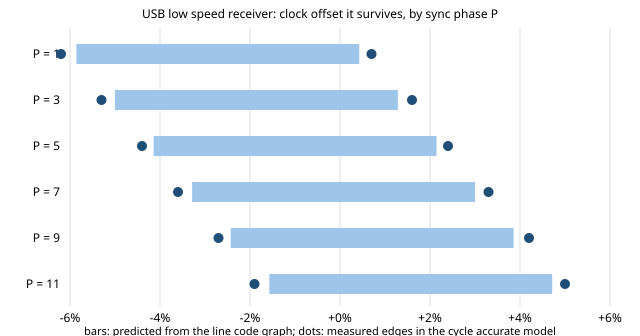

# Weft

A small chip that learns new wire protocols from software, built for the Jane Street protocol emulator ASIC competition.

Weft is a protocol emulator for the Tiny Tapeout IHP 130 nm shuttle in an 8x4 tile slot. It has four small processors called shuttles that move bits between pins and FIFOs with exact cycle timing, in the spirit of the RP2040 PIO. Each shuttle also carries two pieces of hardware that a host can reprogram: a line coder, which is a finite state transducer stored as a table, and a CRC unit with any width and polynomial up to 32 bits. The toolchain can prove things about a line coder table before it is loaded, including how much clock error a receiver built on it will survive. A cycle accurate experiment confirms that prediction to within half a percent.

## The idea

Most serial protocols are built from three layers.

- The bottom layer is timing. A bit lasts so many clock cycles, and a clock line toggles at fixed points.
- The middle layer is a line code. NRZI, Manchester and bit stuffing all turn data bits into line symbols with a small amount of memory, so each one is a finite state machine.
- The top layer is an error check. A CRC is a linear map over GF(2), so one LFSR with a programmable polynomial covers all of them.

Weft gives each layer its own programmable hardware. The shuttle program and its fractional clock divider handle timing. The line coder handles the line code. The CRC unit handles the check. A new protocol is then a short program plus a table and a polynomial, which the host loads over SPI.

## Architecture

| Part | What it is |
| --- | --- |
| Shuttles | Four engines, each with X and Y registers, 32 bit input and output shift registers, a 5 bit delay field on every instruction, up to 3 side-set pins, wrap registers for free loops, and 4 byte TX and RX FIFOs |
| Instruction memory | 64 instructions of 24 bits, shared by all shuttles |
| Clock divider | 16 bit integer and 8 bit fraction per shuttle. An optional resync restarts the divider on every edge of a chosen pin, which works as a digital clock recovery loop |
| Line coder | 16 states, 32 entries of 7 bits per shuttle. Each transmit step sends exactly one line symbol and uses zero or one data bit. Each receive step reads exactly one symbol and produces zero or one data bit. An optional differential output drives a pin pair such as USB D- and D+ |
| CRC unit | Galois LFSR per shuttle, width 1 to 32, any polynomial, initial value and final XOR of all zeros or all ones, fed with the bits that pass through IN or OUT. `MOV OSR, CRC` loads the result ready to send, and `JMP CRCOK` checks a received frame |
| Pins | 16 input bits and 16 output bits. Pins 8 to 15 are bidirectional and can be open drain. The highest numbered shuttle that enables a pin drives it |
| Host port | SPI target on four pins with a 15 bit address space for programs, configuration, line coder tables and FIFOs |

The instruction set has ten opcodes: `JMP` (16 conditions), `WAIT`, `IN`, `OUT`, `PUSH`, `PULL`, `MOV`, `SET`, `IRQ` and `CTL`. The full definition, with every corner case and the register map, is in [docs/spec.md](docs/spec.md).

## Line codes as data

A line coder table entry holds a next state, an output bit, a transfer bit and a flag bit. The transfer bit is the important part. On transmit it says whether the step used a data bit, and on receive it says whether the step produced one. That single rule lets one table format express codes that change the number of symbols per bit.

- NRZI needs 2 states.
- Manchester needs 3 states, because one data bit becomes two symbols.
- USB needs 14 states for bit stuffing and NRZI together. After six 1s the transmitter emits a stuffed bit without using any data, and the receiver drops it.
- CAN stuffing needs 11 states.
- HDLC zero insertion needs 6 states.

Since a table is a finite automaton, the toolchain can analyse it exactly before it goes on the chip. `python -m weft.analysis` prints the following for every built-in code.

| Code | States | Round trip | Longest run R | Max running sum | Symbols per bit | Tolerance, 1 tick per bit, M = 16 | Tolerance, 2 ticks per bit, M = 33.3 |
| --- | --- | --- | --- | --- | --- | --- | --- |
| NRZI | 2 | proved | unbounded | unbounded | 1 | none | none |
| USB | 14 | proved | 7 | unbounded | 1 to 7/6 | 6.25% | 3.14% |
| CAN | 11 | proved | 5 | unbounded | 1 to 5/4 | 8.75% | 4.40% |
| Manchester | 3 | proved, latency 1 | 2 | 2 | 2 | 21.9% | 11.0% |
| HDLC | 6 | proved | unbounded | unbounded | 1 to 6/5 | none | none |

The analyses are graph algorithms on the encoder's configuration graph.

- The round trip proof explores the product of the encoder and the decoder over every input bit string and shows that decoding always returns the input with bounded latency and no error flags.
- The longest run R of identical line symbols is a longest path in the subgraph of steps that repeat the previous symbol. A cycle in that subgraph means R is unbounded.
- The running digital sum bound uses Bellman-Ford on symbols weighted plus or minus one.
- The symbol rate bounds are Karp's minimum and maximum mean cycle on the ratio of symbols to data bits.

The CAN row shows why the exact analysis is useful. The worst case rate is 5/4, which is higher than the 6/5 that a quick reading of the rule suggests, because a stuffed bit can start a new run of five.

## How much clock error can a receiver survive?

A receiver that resyncs on every edge only drifts while the line holds still, and the line coder bounds how long that is. If a shuttle ticks k times per bit and samples on one of those ticks, then after an edge its tick positions sit at s, s + 1/k, and so on. After a resync the program can land on any of them, so the earliest and latest positions are the ones that matter. With R symbols at most between edges, M clock cycles per symbol and q cycles of uncertainty from the synchronizer and the fractional divider, the receiver works for every clock offset d with

```
-(1/k - s - q/M) / R  <  d  <  (s - q/M) / R
```

and the best choice s = 1/(2k) gives |d| < (1/(2k) - q/M) / R. R comes from the line coder table, k from the program, M from the divider, and s from the `SYNC_PHASE` register.

[experiments/cdr_sweep.py](experiments/cdr_sweep.py) tests the bound. A USB low speed transmitter on shuttle 0 sends packets that force the longest runs to a receiver on shuttle 1 over the same pins, and the transmitter's divider is detuned in 0.1% steps until packets fail. This runs in the cycle accurate model, which the lockstep tests hold equal to the RTL.



| Sync phase P | Predicted range | Measured range |
| --- | --- | --- |
| 1 | -5.86% to +0.43% | -6.20% to +0.70% |
| 3 | -5.00% to +1.29% | -5.30% to +1.60% |
| 5 | -4.14% to +2.14% | -4.40% to +2.40% |
| 7 | -3.29% to +3.00% | -3.60% to +3.30% |
| 9 | -2.43% to +3.86% | -2.70% to +4.20% |
| 11 | -1.57% to +4.71% | -1.90% to +5.00% |

For all six sync phases the window moves exactly as predicted, and each measured edge sits between 0.27% and 0.34% outside the predicted one. The bound is therefore safe and close to tight. At P = 7 the receiver tolerates about 3% either way, which is twice the 1.5% that the USB specification allows a low speed device.

The first version of this experiment used a symmetric bound and a sync phase chosen by eye, and it failed on one side. Following that failure up gave the asymmetric form above. In this design the sample point after an edge comes from the synchronizer latency as much as from `SYNC_PHASE`.

## Protocols

Every program is in [programs/](programs), and every test drives the chip only through its pins and the SPI port.

| Protocol | Program | What checks it |
| --- | --- | --- |
| UART 8N1 transmit | `uart_tx.weft` | A decoder that samples mid-bit and checks start and stop bits |
| UART 8N1 receive | `uart_rx.weft` | Frames driven on a pin, including a bad stop bit that must raise IRQ 0 |
| SPI controller, mode 0 | `spi_master.weft` | An SPI target model that checks MOSI and replies on MISO, with CS held across bytes |
| I2C controller write | `i2c_write.weft` | An open drain I2C target model that checks START, address, data and STOP and ACKs or NACKs |
| USB low speed transmit | `usb_ls_tx.weft` | A decoder written from the USB specification that undoes NRZI and stuffing and checks the CRC16 |
| USB low speed receive | `usb_ls_rx.weft` | Loopback from the transmitter, with clock recovery, destuffing and a CRC16 residue check on the chip |
| CAN 2.0A transmit | `can_tx.weft` | A decoder written from ISO 11898 that checks stuff bits, CRC-15, delimiters and EOF |

The USB and CAN transmitters use the same two blocks with a different table and polynomial. Both keep a fixed number of ticks per symbol right up to the last stuffed bit by testing the `MORE` jump condition, which is true while an `OUT` would find data in the OSR, in the FIFO or pending in the line coder.

## Verification

Two separate implementations were written from [docs/spec.md](docs/spec.md): the Verilog in [src/](src) and a cycle accurate Python model in [weft/model.py](weft/model.py). The tests check them against each other and against the protocols.

- **Lockstep random testing** ([test/test_lockstep.py](test/test_lockstep.py)). Each trial builds a random 64 instruction program and random configurations, line coder tables, CRC settings and FIFO contents for all four shuttles. It loads them into the RTL through the SPI port and into the model through its register interface, then drives random pin inputs. On every clock cycle it compares every output pin, the IRQ flags and fifteen architectural registers of every shuttle. This found one real gap in the spec: the meaning of a count field above 32, which the RTL and the model read differently. The spec now defines it.
- **Protocol tests** ([test/test_protocols.py](test/test_protocols.py)) against peer models and decoders in [test/peers.py](test/peers.py) that share no code with the Weft toolchain.
- **Model and toolchain tests** ([weft/tests](weft/tests)), 149 of them. They cover the assembler round trip, every catalogue CRC (USB CRC5 and CRC16, CRC-32, CAN CRC-15, SMBus CRC-8, CRC-7, CRC-16/CCITT) sent bit-exact on the wire through `MOV OSR, CRC`, and the line code analyses.

Formal proofs are not done yet. The design has not run on an FPGA either.

## Building and testing

```bash
pip install cocotb pytest
python -m pytest weft -q
cd test && make
python -m weft.asm programs/usb_ls_tx.weft
python -m weft.analysis
python experiments/cdr_sweep.py --plot sweep.svg
```

The cocotb tests need Icarus Verilog. `LOCKSTEP_TRIALS`, `LOCKSTEP_CYCLES` and `LOCKSTEP_SEED` control the random lockstep run. Make does not handle a project path that contains spaces, so run it from a path without them.

## Repository layout

| Path | Contents |
| --- | --- |
| `src/` | Verilog: `project.v` (top level), `weft_shuttle.v`, `weft_host.v` |
| `docs/spec.md` | The architecture, instruction set and register map |
| `programs/` | Protocol programs in Weft assembly |
| `weft/` | Assembler, cycle accurate model, configuration helper, line codes, CRC catalogue and analysis |
| `test/` | cocotb tests, host SPI driver and peer models |
| `experiments/` | The clock tolerance sweep |
